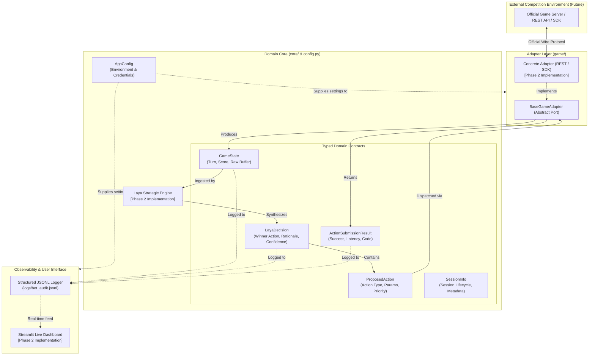

# GenesisBot V2 Architecture

## Overview

GenesisBot V2 is a modular, high-reliability game-playing agent designed for competitive hackathons. The architecture employs the **Ports and Adapters (Hexagonal) Pattern**, completely decoupling the strategic decision-making engine from external game transports, vendor SDKs, and wire protocols.

This ensures that the bot's core strategy, state evaluation, and observability remain resilient and testable, even before official hackathon APIs or SDK specifications are released.

---

## Architectural Diagram

---

## Component Breakdown

### 1. Configuration (`config.py`)
- Provides strongly-typed, schema-validated runtime configuration via Pydantic.
- Reads environment variables backed by local `.env` files via `python-dotenv`.
- Ensures zero hardcoded credentials, API keys, or URLs in source code.

### 2. Core Domain Models (`core/models.py`)
- **`SessionInfo`**: Tracks match/tournament session identity, timestamps, and lifecycle states.
- **`GameState`**: Internal representation of game state. Includes an unmapped `raw_state` dictionary that acts as a forward-compatible buffer, preventing crashes when novel server-side fields appear.
- **`ProposedAction`**: Standardized representation of potential actions generated by heuristic or ML evaluation modules.
- **`LayaDecision`**: Encapsulates the strategic selection made by "Laya" (the decision engine persona), containing the chosen action, rationale, confidence score, and evaluated alternatives.
- **`ActionSubmissionResult`**: Transport-agnostic feedback envelope capturing success/failure, HTTP/protocol codes, roundtrip latency, and raw diagnostic responses.

### 3. Game Adapter Layer (`game/base_adapter.py`)
- **`BaseGameAdapter`**: Abstract base class declaring the port for game interactions:
  - `read_game_state() -> GameState`
  - `submit_action(action: ProposedAction) -> ActionSubmissionResult`
  - `check_submission_result(result: ActionSubmissionResult) -> bool`
  - Lifecycle hooks: `connect()`, `close()`, `is_connected()`
- Concrete implementations (e.g. `OfficialRestAdapter`, `MockSandboxAdapter`) isolate external network details from the rest of the codebase.

### 4. Structured JSONL Logging (`core/logger.py`)
- Standard-library logging configured with `JSONLFormatter`.
- Emits atomic, newline-delimited JSON entries to disk and console.
- Enables machine-readable audit trails for turn replay, strategy debugging, and telemetry aggregation.

### 5. Streamlit Dashboard (Phase 2+)
- Decoupled visualization layer that reads active session telemetry, current game states, and historical decisions without interfering with the low-latency game loop.

---

## Design Principles

1. **Anti-Corruption Layer (ACL)**: GenesisBot never binds internal business logic directly to external JSON payloads or vendor SDK structures. All inputs and outputs pass through adapter translation.
2. **Fail-Safe Robustness**: Network timeouts, parsing failures, and API anomalies are trapped at the adapter boundary and surfaced as structured `ActionSubmissionResult` objects with `success=False`.
3. **Auditability**: Every turn, decision, and submission is recorded as a structured JSONL event with UTC timestamps and latency metrics.
4. **Minimal Surface Area**: Phase 1 avoids speculative abstractions, keeping models tight and focused on core capabilities.
